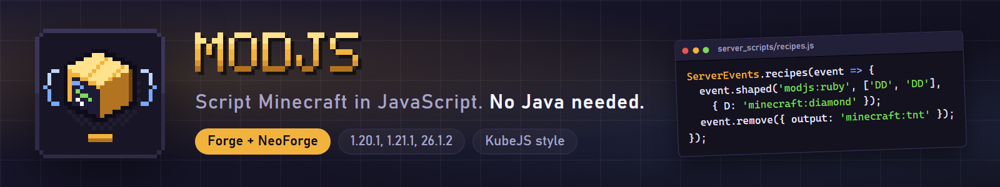
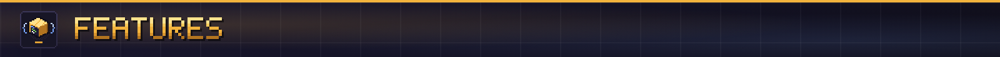
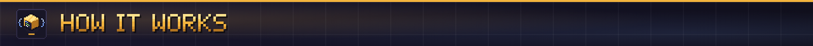
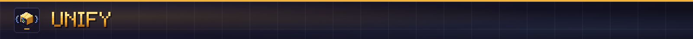
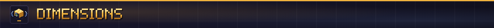
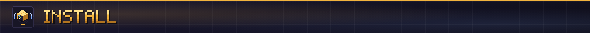
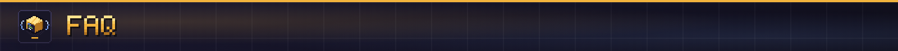

**Script Minecraft in JavaScript. Add items, blocks, recipes and whole dimensions, react to gameplay and rebuild the main menu, all from plain text files.**

ModJS is a scripting mod for Forge and NeoForge, built on the Rhino JavaScript engine. Drop `.js` files in a `modjs/` folder and the game runs them. There is no Java, no build step and no mod project. If you know KubeJS, you already know the layout.

**Full guide:** [itmecasey.com/wiki/modjs](https://itmecasey.com/wiki/modjs/)

```js
StartupEvents.registry('item', event => event.create('ruby').displayName('Ruby'));
ServerEvents.recipes(event => event.shaped('modjs:ruby', ['DD', 'DD'], { D: 'minecraft:diamond' }));
```



- **Items, blocks and fluids:** register your own, with tools, armor, slabs, stairs, walls, fences and storage blocks. Models, language entries and block loot are generated for you.
- **Recipes, tags and loot:** shaped, shapeless, smelting, stonecutting and smithing, plus remove and replace with filters. Edit any loot table or add new ones.
- **World generation:** add ore veins and features, remove them, and change which mobs spawn where.
- **Gameplay events:** block broken, player joined, chat sent, item used, entity hurt, and many more. Cancel an action or rewrite it.
- **Dimensions:** add, edit, duplicate and drop dimensions, or create them while the server runs. Give every player who joins their own.
- **Game state:** read and edit chests, furnaces and signs, change game rules, and save values between restarts.
- **Client side:** rename things, add tooltips, change the splash text, rebuild the title screen and make your own screens with buttons and text boxes.



Scripts go in three folders inside `modjs/`:

- `startup_scripts` run once while the game loads and register content.
- `server_scripts` run when a world loads and reload with `/modjs reload`.
- `client_scripts` run on the client and reload with F3+T.

`/modjs hand` prints the id of the item you hold, `/modjs errors` lists script errors and `/modjs trace on` prints every event as it fires. Editors such as VS Code complete every name, because ModJS writes a type file on each launch.



Three mods add tin and you end up with three tin ingots that do not stack. **Unify** works like the old Ore Dictionary: it picks one canonical item per material and converts every recipe, drop, inventory and ore in the world to it.

- Generates items for materials (ingots, nuggets, dusts, plates, gears, rods, wires, coins, raw items, storage blocks and ores), with art recolored from the game's own textures and colors read from the mods you already have.
- Rewrites recipe outputs and inputs, loot from blocks, mobs, chests and fishing, and items already in player inventories.
- Can force new chunks to place the canonical ore.
- Works from a config file with no script at all. [How Unify works](https://itmecasey.com/wiki/modjs/?p=unify)



```js
PlayerEvents.loggedIn(event => {
  const id = 'mymod:player_' + event.player.getStringUUID().replace(/-/g, '');
  Dimensions.create(id, { generator: 'void' });
  Dimensions.teleport(event.player, id, 0.5, 64, 0.5);
});
```

A hub plus a private dimension for every player, created while the server runs and kept across restarts. [Dimensions at run time](https://itmecasey.com/wiki/modjs/?p=dimensions-runtime)



- Pick the jar for your Minecraft version and loader: **26.1.2, 1.21.1 or 1.20.1** on **Forge or NeoForge**. On NeoForge 1.20.1 use the `-all` jar.
- Install it on both the client and the server. Items and blocks you register are real registry entries.
- Start the game once. ModJS creates the `modjs/` folder.
- Just Enough Items (1.21.1 and 1.20.1) and Barely Enough Items (Forge 26.1.2) can be controlled from scripts: hide items, add information pages and hide categories.



**Is it KubeJS?** No. It shares KubeJS's structure so scripts translate with few changes, but it is its own mod, with Unify, run-time dimensions, game rules and scripted screens on top. [Coming from KubeJS](https://itmecasey.com/wiki/modjs/?p=kubejs-parity)

**Can I add a new mob?** Not yet. A mob needs a model, a renderer and AI that a script cannot supply safely.

**Does it work with EMI or REI?** Not yet. Neither publishes a Forge build to compile against.

**How well is it tested?** All six builds pass the same unit tests and a headless server self-test on every push. Client-side features have had little time on a real client, so report anything that looks wrong.

**Can I use it in my modpack?** Yes.

Source and issues on [GitHub](https://github.com/ItMeCasey/ModJS).
